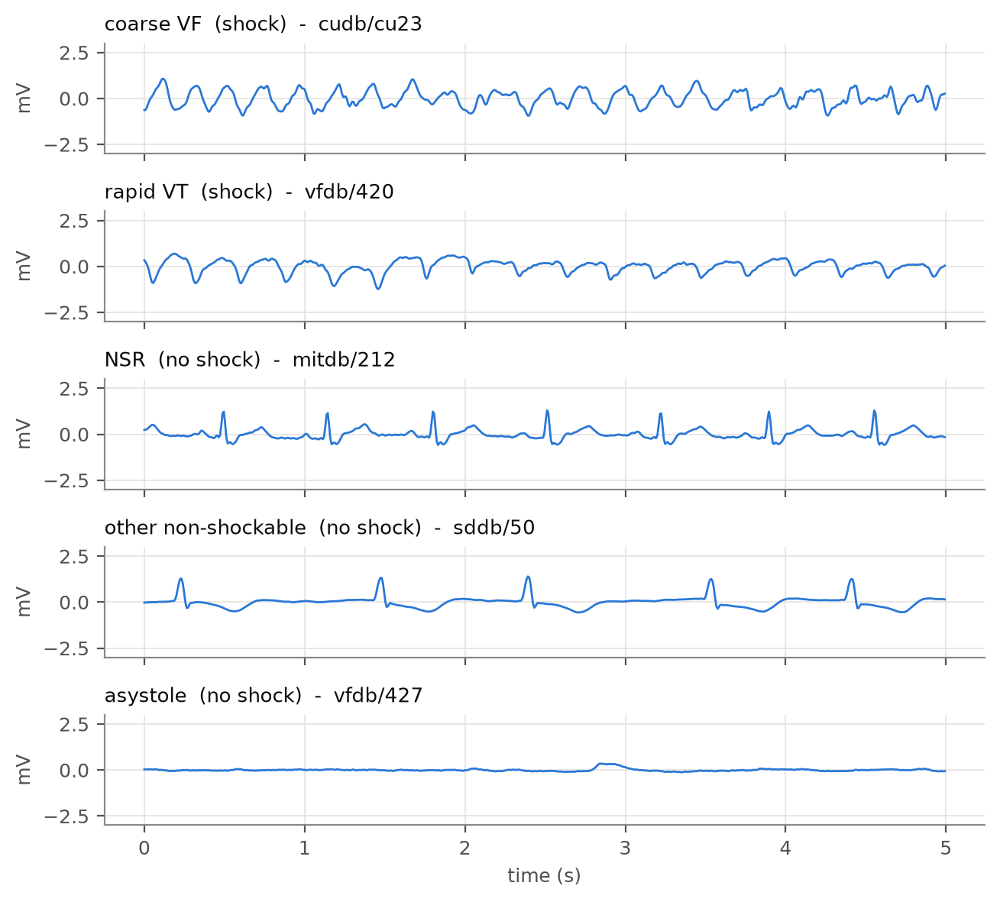
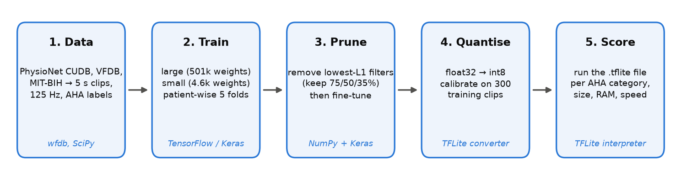
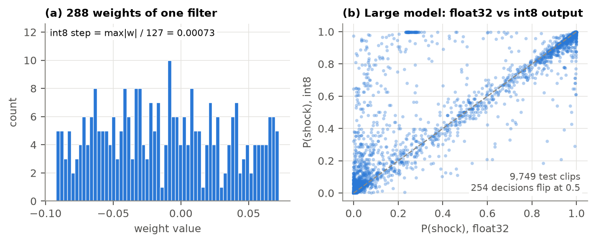
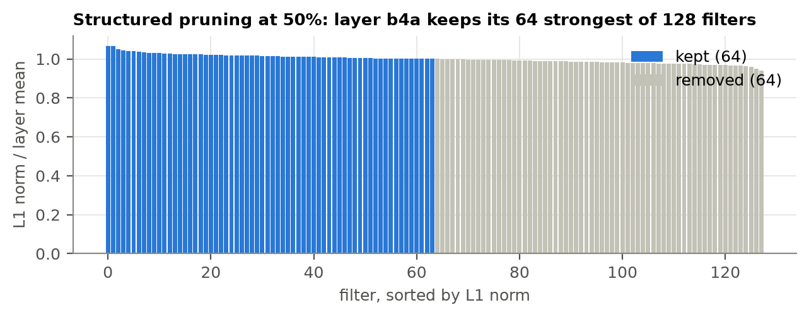
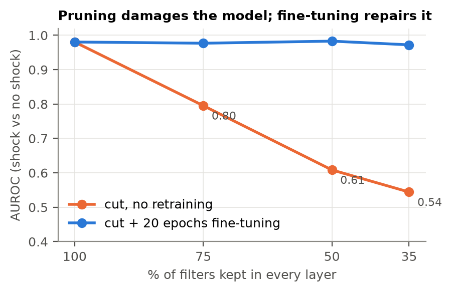
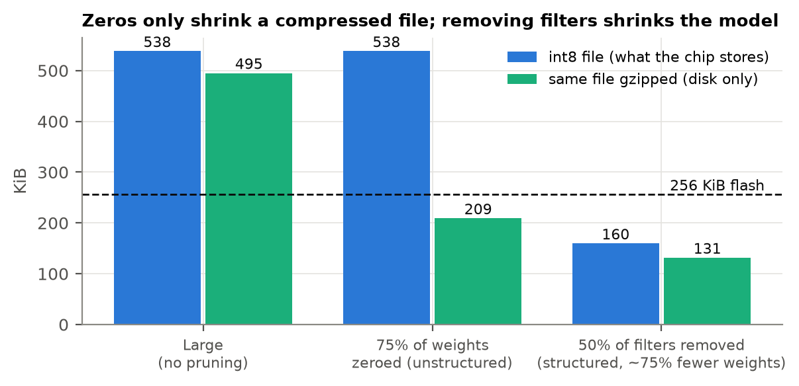
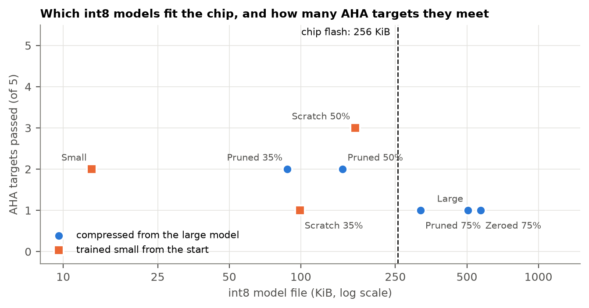
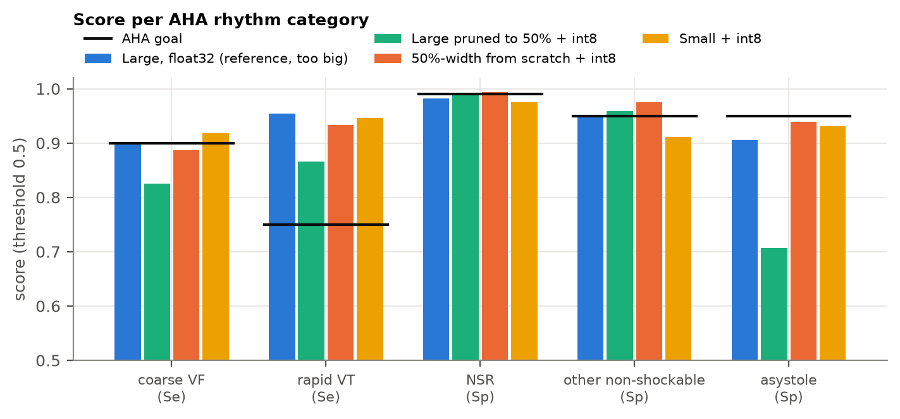
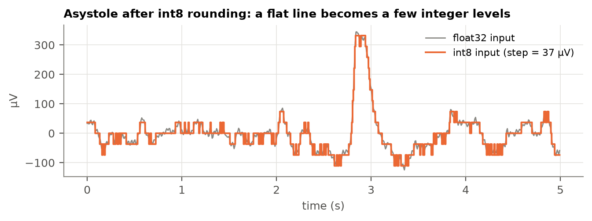

% Shrinking a Shock-Advice Network to Fit an AED Chip
% ESP3201A Machine Learning in Robotics and Engineering, Final Project Report
% Huang JingWei (A0307445E) and partner · 6 November 2026

# Abstract

An automated external defibrillator (AED) has to decide, from a few seconds of ECG, whether a heart in cardiac arrest needs a shock, and it makes that call on a small, battery-powered microcontroller. We trained a deep-learning shock-advice model and asked how far it can be compressed, with quantisation and pruning, to fit an AED-class chip (STM32L432: 256 KiB flash, 64 KiB RAM) while still meeting the American Heart Association (AHA) accuracy targets for each heart rhythm. We also asked whether it is better to compress a big model or to train a small one from the start. Because a first version of this study rested on only 100 patients, we combined five public PhysioNet databases into 9,749 five-second clips from 863 people (shockable rhythms from 79 people, asystole from 28), capped at five minutes of each rhythm per person, and evaluated by patient-wise 5-fold cross-validation. On this larger and harder dataset, the uncompressed model passes 2 of the 5 AHA targets. The best model that fits the chip is a network at half the large model's width, trained from scratch and quantised to int8: 160 KiB of flash and 15 KiB of RAM, 12 times smaller than the original, passing 3 targets and missing coarse VF by 1.4 points and asystole by 1 point. Its float32 version passes 4, so the limiting step is post-training int8 quantisation, which on this data changed 2–7% of the compressed networks' decisions and depended strongly on which clips were used to calibrate it. Networks trained small from scratch matched or beat pruned networks of the same shape, and survived quantisation better.

# 1. Introduction

Someone collapses at a void deck. A passer-by opens the AED on the wall, sticks two pads on the chest and presses nothing else. Within about ten seconds the machine has to say one of two things: "shock advised" or "no shock advised". Get it wrong one way and a heart that could have been restarted is left in fibrillation. Get it wrong the other way and a person whose heart is still beating gets an electric shock they did not need.

That decision is made by a rhythm-analysis algorithm running on the AED's microcontroller. Simple enough on paper, but the chip is tiny. The one we target, an STM32L432 (Arm Cortex-M4 at 80 MHz), has 256 KiB of flash to store the program and model, and 64 KiB of RAM to run it. That is smaller than a single photo on a phone. A typical deep-learning model, even a modest one, is measured in megabytes. Our own "large" model is 2 MB in its normal float32 form, eight times too big.

This is where model compression comes in. **Quantisation** stores each number in the model with fewer bits. **Pruning** removes parts of the model that contribute little. Both are standard tools for running neural networks on small devices, but they are usually judged on overall accuracy. An AED is judged differently. The AHA sets a separate target for each type of heart rhythm (Kerber et al., 1997), and a device must meet all of them. A compressed model that keeps its overall accuracy but quietly gets worse at one rhythm would still fail.

So this project asks two questions:

1. **How far can a shock-advice network be compressed to fit an AED-class chip while still meeting the AHA rhythm targets?**
2. **Is it better to compress a big, accurate model, or to train a small model from the start?**

The second question is what gives compression a point. If a small model trained from scratch does just as well, there is no reason to train a big one and shrink it.

We are not the first to put a neural network in an AED. The Avive AED, approved by the US FDA in 2022 (PMA P210015), already uses one. Our contribution is not a new detector. It is a careful look at what compression does to each rhythm category, measured honestly: by patient, with confidence limits, on the target chip's real memory budget.

# 2. What an AED must get right

So what counts as "right" for an AED? The answer depends on the rhythm.

**Shockable rhythms** are the ones a shock can fix. In **ventricular fibrillation (VF)** the heart's lower chambers quiver chaotically and pump no blood. In **rapid ventricular tachycardia (VT)** they beat so fast that they barely fill between beats. **Non-shockable rhythms** include normal sinus rhythm (NSR), other abnormal but organised rhythms such as atrial fibrillation (AF), and **asystole**, a flat line, where there is no electrical activity for a shock to reset. Fig. 1 shows a typical example of each.

The AHA recommendations (Kerber et al., 1997) turn this into five numbers (Table 1). For shockable rhythms they set a minimum **sensitivity**, the share of shockable clips the device correctly shocks. For non-shockable rhythms they set a minimum **specificity**, the share of non-shockable clips it correctly leaves alone. In other words, sensitivity asks "of the people who needed a shock, how many got one?", and specificity asks "of the people who did not, how many were spared?".

Table 1: AHA performance goals for AED rhythm analysis (Kerber et al., 1997). The last column is the lowest acceptable one-sided 90% lower confidence limit.

| Rhythm | Should the AED shock? | Measured by | Goal | Lowest acceptable lower limit |
|---|---|---|---|---|
| Coarse VF (≥ 200 µV) | Yes | Sensitivity | > 90% | 87% |
| Rapid VT | Yes | Sensitivity | > 75% | 67% |
| Normal sinus rhythm | No | Specificity | > 99% | 97% |
| Other non-shockable (AF, SVT, blocks, ...) | No | Specificity | > 95% | 88% |
| Asystole (< 100 µV) | No | Specificity | > 95% | 92% |
| Fine VF, other VT | Either | Report only | none | none |

Two details matter later. First, the NSR target, 99% specificity, is the strictest. Most people an AED is attached to by mistake are fainting, not in cardiac arrest, so false shocks on normal rhythm must be very rare. Second, the AHA asks for a **lower confidence limit**, not just a score. A 96% score measured on 10 patients is far weaker evidence than 96% on 1,000. The lower limit is a pessimistic estimate: the score we can be 90% sure the device beats.

# 3. How compression works

## 3.1 Quantisation: fewer bits per number

A trained network is mostly a long list of numbers, its **weights**. Normally each is stored as a 32-bit floating-point number (float32), which can hold values like 0.04127 with about seven digits of precision. **Quantisation** stores each one as an 8-bit integer (int8) instead: a whole number from −128 to 127. That alone makes the model four times smaller.

So how does an integer stand in for 0.04127? Each tensor gets a **scale** and a **zero point**, and

*real value ≈ scale × (integer − zero point)*

Take one real filter of our large model (Fig. 3a). Its largest weight magnitude is 0.0922. TensorFlow Lite gives weights a symmetric range, so the zero point is 0 and the scale is 0.0922 / 127 = 0.000726. A weight of 0.02788 becomes round(0.02788 / 0.000726) = round(38.4) = 38. Converted back, 38 × 0.000726 = 0.02758, an error of 0.00030. No weight moves by more than half a step (0.00036). That is the whole trade: a small rounding error on every number, in exchange for a four-times smaller model and integer-only arithmetic.

The weights are only half the story. While the model runs, every layer also produces **activations**, the intermediate signals passed to the next layer. There are two common ways to handle them:

- **Dynamic-range quantisation** stores the weights as int8 but keeps activations in float32. The weights are converted back to float on the fly. It needs no data and shrinks the file about four times, but the chip still does floating-point maths.
- **Full-integer quantisation** makes activations int8 too. Their ranges are not known in advance, so the converter runs a few hundred **calibration** clips through the model and records how large each activation gets. That range sets each activation's scale and zero point. The result runs entirely on integer arithmetic, which is what fast microcontroller kernels such as CMSIS-NN are built for (Lai et al., 2018).

Both are **post-training quantisation (PTQ)**: the model is trained normally and converted afterwards (Jacob et al., 2018; Krishnamoorthi, 2018). The alternative, **quantisation-aware training (QAT)**, simulates the rounding during training so the model learns to tolerate it. QAT is only worth its extra cost when PTQ loses accuracy. We used PTQ throughout, because it is what the standard TensorFlow Lite toolchain offers out of the box; Section 6.2 shows that on our data it does lose accuracy, which makes QAT the obvious next step (Section 7).

## 3.2 Pruning: removing parts of the model

**Pruning** removes the parts of a network that matter least. The common way to judge "matters least" is size: a weight close to zero barely changes the output, so it can go. There are two very different ways to remove things.

**Unstructured pruning** sets individual weights to zero, wherever they are (Han et al., 2015). It can remove a large share of weights with little accuracy loss. The catch is that the network keeps its shape. A layer with 75% of its weights set to zero is still stored and computed as a full layer, unless the hardware and software have special sparse kernels, which a Cortex-M4 running TensorFlow Lite Micro does not. The zeros make the file compress well on disk, but on the chip the model is exactly as big and as slow as before.

**Structured pruning** removes whole **filters** (the feature detectors in a convolutional layer) instead. Removing filter *j* of a layer removes output channel *j*, and therefore also input channel *j* of the next layer. The result is a genuinely narrower network with fewer weights, less computation and smaller activations. We rank filters by their **L1 norm**, the sum of the absolute values of their weights, and keep the strongest (Li et al., 2017). Fig. 4 shows this for one layer.

There is one complication in our model. It is a residual network (He et al., 2016): each block adds its input to its output through a shortcut. Two tensors can only be added if their channels line up, so the filters on both sides of each addition must be chosen together. We sum their L1 scores and keep one shared set of channel positions for both.

Cutting filters damages the model, so pruning is always followed by **fine-tuning**: a few more epochs of training at a lower learning rate, which lets the remaining filters adjust to the loss of their neighbours. This raises a fair question, asked by Liu et al. (2019): if the pruned network is retrained anyway, why not just train a network of that narrow shape from scratch? We test exactly that.

# 4. Related work

Deep learning for AED shock advice is well studied. Nguyen et al. (2018) combined a convolutional feature extractor with a boosting classifier on the same PhysioNet databases we use. Jaureguibeitia et al. (2020) showed that convolutional and residual networks can meet the AHA targets on segments as short as a few seconds. These papers report accuracy but not embedded cost: model size, memory or speed on a real chip.

On the other side, the TinyML Design Contest 2022 (Jia et al., 2023) asked teams to detect life-threatening ventricular arrhythmias on the same STM32L432 board we target. Its signals, however, come from inside the heart, recorded by implantable defibrillators, not from AED pads on the chest, and its scoring is not per AHA category.

The gap we fill is the overlap. We found no work reporting how quantisation and pruning change each AHA rhythm category separately, under the memory budget of an AED-class microcontroller.

# 5. Method

The whole pipeline fits in four words: train, prune, retrain, convert. The rest of this section explains each step and the tools used (Fig. 2).

## 5.1 Data

Our first version used the three PhysioNet databases that are standard in shock-advice research (Goldberger et al., 2000): the Creighton University Ventricular Tachyarrhythmia Database (CUDB), the MIT-BIH Malignant Ventricular Ectopy Database (VFDB) and the MIT-BIH Arrhythmia Database (Moody and Mark, 2001). Together they hold only 100 patients, and asystole came from just 6 of them. So we added two more public databases, each chosen to fill a specific gap:

- **The Sudden Cardiac Death Holter Database (SDDB)** (Greenwald, 1986): 24-hour recordings from 23 people who had a cardiac arrest while wearing the recorder, 20 of them in VF. It adds new VF patients, and the hours before each arrest add normal and AF rhythm from the same people.
- **The PhysioNet/CinC 2015 Challenge set** (Clifford et al., 2015): 750 recordings from intensive-care bedside monitors, each ending in a life-threatening-arrhythmia alarm that experts marked as true or false. It adds real asystole (22 true alarms) and, from the 456 false alarms, something no other public set offers in bulk: noise and organised rhythms that fooled a monitor into calling VF, VT or asystole. These are exactly the signals an AED must *not* shock.

Each recording was reduced to one lead (lead II where available), resampled to 125 Hz and band-pass filtered (0.5–30 Hz) to remove baseline drift and muscle noise. It was then cut into non-overlapping **5-second clips** (625 samples), a typical AED analysis window. Labels came from each database's own information:

- **CUDB, VFDB, MIT-BIH**: the rhythm annotations; clips where the rhythm changes or that are marked as noise were dropped.
- **SDDB**: the published VF onset time. We plotted every episode and kept only the stretch that is still VF (15–120 s per person), dropping two unclear episodes. Normal and AF clips come from the annotated rhythm at least 10 minutes before the arrest, skipping any clip with a ventricular beat.
- **CinC 2015**: the 5 s just before each alarm. True VF and asystole alarms give VF and asystole clips; true slow- or fast-heart-rate alarms and every false alarm give non-shockable clips. True VT alarms fire after only five ventricular beats, which need not be the sustained VT an AED should shock, so we kept them as report-only "other VT".

VF clips were split into coarse and fine by amplitude (200 µV), and VT clips into rapid and other by heart rate (180 bpm). The rate cut-off is our own choice: the AHA statement does not fix one number, so we flag it as an assumption.

**One person, at most five minutes of each rhythm.** Long recordings let one person dominate: a single 30-minute MIT-BIH recording gives up to 360 nearly identical normal-rhythm clips. We therefore kept at most 60 clips (5 minutes) per person per rhythm category, spread evenly over the recording. This keeps every shockable person and 83% of the shockable clips, but cuts 143,598 candidate clips to 9,749, and makes about one clip in five shockable instead of one in twelve. Table 2 shows the result.

Table 2: Clips per AHA category after the per-person cap, by source database, and the number of people behind them.

| Category | CUDB | VFDB | MIT-BIH | SDDB | CinC 2015 | Clips | People |
|---|---|---|---|---|---|---|---|
| coarse VF | 697 | 269 | 24 | 342 | 6 | 1,338 | 66 |
| rapid VT | 2 | 372 | 0 | 0 | 0 | 374 | 16 |
| NSR | 96 | 848 | 2,340 | 900 | 0 | 4,184 | 72 |
| other non-shockable | 73 | 542 | 970 | 1,020 | 624 | 3,229 | 677 |
| asystole | 0 | 94 | 0 | 0 | 22 | 116 | 28 |
| fine VF | 1 | 1 | 0 | 2 | 0 | 4 | 3 |
| other VT | 0 | 398 | 17 | 0 | 89 | 504 | 105 |
| **Total** | 869 | 2,524 | 3,351 | 2,264 | 741 | 9,749 | 863 |

Compared with the three original databases, the shockable rhythms now come from 79 people instead of 55, asystole from 28 people instead of 6, and the non-shockable rhythms from 732 people instead of 69. Two caveats remain. Each CinC 2015 recording is counted as a separate person, because the challenge does not publish patient identities. And rapid VT still comes from only 16 people, because no added database has sustained VT that we could label with confidence.

## 5.2 Splitting by patient

Clips from the same person look alike. If one patient's clips land in both the training and the test set, the model can recognise the person rather than the rhythm, and the test score is inflated. Many published shock-advice results split clips at random and suffer from exactly this.

We split by **patient** instead, with 5-fold cross-validation: the patients are divided into five groups, and each group takes one turn as the test set while the model trains on the other four. Of the training patients, one in six (about 115 people per fold) are held back as a **validation** set, used only for early stopping, for choosing a decision threshold (Section 5.5) and for choosing how to calibrate int8 quantisation (Section 6.2). In other words, every test score in this report comes from people the model never saw during training or tuning. Fine VF and slow VT clips are never trained on, since the AHA sets them no target, but they are still scored and reported.

## 5.3 Two models

The **large model** is a one-dimensional residual network: a first convolution, four residual blocks of two convolutions each (32, 64, 96 and 128 filters), and a small dense head. It has 501,537 weights and needs about 36.7 million multiply-accumulate operations (MACs) per clip. It is our "accurate reference": it does not fit the chip.

The **small model** has three plain convolutional layers (8, 16 and 32 filters) and 4,625 weights, about a hundred times fewer. It was designed to fit the chip from the start.

Both read one 5 s clip and output a probability that the rhythm is shockable. Both were trained with the Adam optimiser and binary cross-entropy loss, for up to 40 epochs with early stopping on the validation loss. Because shockable clips are rarer than non-shockable ones, the two classes were weighted equally during training. The large model uses batch normalisation (Ioffe and Szegedy, 2015), which keeps a running average of each layer's statistics for use at test time. With the Keras default (momentum 0.99) that average lagged far behind the changing weights, because each epoch of the capped dataset is only about 50 training steps: validation loss jumped between epochs, early stopping restored half-trained models, and one fold's large model scored an AUROC of only 0.79. Setting the momentum to 0.9 removed the problem (AUROC 0.99 from the second epoch); all results below use it.

## 5.4 Compression

From each fold's trained large model, we made the following variants:

- **Structured pruning** keeping 75%, 50% and 35% of the filters in every layer. Because a layer's weights scale with both its input and output width, keeping 50% of filters leaves about a quarter of the weights. Each pruned model was fine-tuned for up to 20 epochs at a learning rate of 3 × 10⁻⁴.
- **Train-from-scratch twins** of the 50% and 35% shapes: the same narrow architecture, randomly initialised and trained like the large model. This is the control for question 2.
- **Unstructured pruning** setting 75% of the weights in every layer to zero, matching the share of weights removed by 50% structured pruning, then fine-tuned with the zeros held at zero.

Every model, compressed or not, was then converted by the TensorFlow Lite converter into three files: float32 (no compression, as the reference), dynamic-range int8 (for the small and large models), and full-integer int8, calibrated on 300 clips drawn from that fold's training patients. *Which* 300 clips turned out to matter, so we compared four ways of choosing them and picked one on the validation patients (Section 6.2). All scores in Section 6 are computed by running the **.tflite files themselves** in the TensorFlow Lite interpreter, the same bytes that would be flashed to the chip.

## 5.5 Measuring success

**Accuracy.** For every AHA category we compute the score (sensitivity or specificity) on the pooled test predictions of all five folds, and its one-sided 90% lower confidence limit. The limit comes from a bootstrap over patients: we resample whole patients with replacement 1,000 times and take the 10th percentile. Resampling patients rather than clips is stricter, because it accounts for clips from one person being alike. A row **passes** only if the score beats the AHA goal *and* the lower limit reaches the AHA's lowest acceptable limit (Table 1).

**Threshold.** A model outputs a probability; the AED shocks if it is above a threshold. The usual default is 0.5, but nothing makes 0.5 special. For each model and fold we also chose the threshold on the *validation* patients: the one with the best worst-case margin over the AHA goals. We report results at both thresholds. The test patients are never used to choose anything.

**Fit on the chip.** Flash use is the size of the .tflite file. RAM use is estimated as the largest set of activation tensors alive at the same moment while the model runs, a lower bound, as the runtime adds a few KiB on top. A model fits if its file is under 256 KiB and its peak activations are under 64 KiB.

**Speed.** We did not have a physical board, so on-chip latency is an *estimate*: the MAC count divided by an assumed 0.5–1 int8 MAC per clock cycle with CMSIS-NN kernels, at 80 MHz. We also report the measured time per clip on a laptop CPU.

# 6. Results

All numbers below are pooled over the five test folds (9,749 clips from 863 people) and use the 0.5 threshold unless stated otherwise. Section 6.8 explains why the tuned threshold is not the headline.

## 6.1 The starting point

Before compressing anything, how good are the uncompressed models? Overall they separate shockable from non-shockable rhythms well: the large model's AUROC is 0.980 and the small model's 0.977. But the AHA asks for more than that, and on this dataset the large float32 model passes only 2 of the 5 rows. Rapid VT (95.5%) and other non-shockable rhythms (95.2%) clear their goals. Coarse VF scores 90.2%, just above the 90% goal, but with 66 people behind it the lower confidence limit (86.2%) misses the 87% minimum. NSR specificity is 98.2%, under the 99% goal, and asystole 90.5%, under 95%. The small model also passes 2.

The surprise is a model we built only as a control: the network at half the large model's width, trained from scratch. In float32 it is the best model in the study, passing 4 of 5 rows (coarse VF 94.9%, rapid VT 94.4%, NSR 99.0%, other non-shockable 97.2%) and failing only asystole (94.0%).

These numbers are lower than in our first version, where the large model passed 3 rows. The pipeline is the same; the test is harder. It now includes ICU false alarms that fooled a monitor into calling VF, VF recorded at the moment of a sudden-death arrest, and nearly five times as many asystole patients. Section 6.7 shows which sources are hardest.

## 6.2 Quantisation: four times smaller, but no longer free

Table 3: The large model in three file formats (same trained weights).

| File | Size (KiB) | AUROC | Decisions changed vs float32 (of 9,749) | AHA rows passed |
|---|---|---|---|---|
| float32 | 1,975 | 0.9805 | 0 | 2 / 5 |
| Dynamic-range int8 | 525 | 0.9806 | 12 | 2 / 5 |
| Full-integer int8 | 538 | 0.9673 | 254 | 1 / 5 |

Table 3 shows the trade. Both int8 formats shrink the file about 3.7 times. Dynamic-range quantisation, which rounds only the weights, changes just 12 decisions. Full-integer quantisation, which also rounds every activation, changes 254 (2.6%), lowers the AUROC from 0.981 to 0.967 and costs one AHA row: other non-shockable specificity falls from 95.2% to 91.5%. Fig. 3b shows where. Most clips sit in the corners, where both versions are confidently right; the changed decisions come from clips whose int8 output scatters away from the diagonal. Full-integer int8 also cuts peak activation memory four times, from 117 KiB to 29 KiB, because every activation is one byte instead of four.

**Calibration matters.** Full-integer int8 needs calibration clips to set each activation's range (Section 3.1). The same trained model gave noticeably different int8 results depending on which 300 clips were drawn: across three random draws, the large model's asystole specificity ranged from 37% to 93%. So we compared four rules for choosing calibration clips, each with three random seeds, on every model of every fold:

- 300 random training clips (the usual choice);
- 1,000 random training clips;
- 300 clips stratified by rhythm, 60 from each AHA category, so rare rhythms are represented;
- 300 random training clips that never hit the ±5 mV clipping limit, which excludes the worst artefacts.

To keep the test patients out of the decision, we chose the rule on the *validation* patients, by how faithfully int8 reproduced the float32 decisions. Excluding saturated clips won clearly: 2,821 changed validation decisions, against 4,040 for random, 4,229 for stratified and 4,714 for 1,000 random clips. The likely reason is that a single artefact spike stretches an activation's range, leaving fewer of the 256 int8 levels for ordinary signals. On the test patients the chosen rule was also more stable: the large model's asystole specificity stayed within 85–91% across seeds. All int8 results in this report use this rule. Even so, quantisation still costs the compressed models accuracy, as the next sections show.

At 538 KiB, the int8 large model is still more than twice the chip's 256 KiB of flash. To fit, the network itself has to get smaller.

## 6.3 Pruning: cut, then repair

What happens straight after filters are cut? Fig. 5 answers it. Removing a quarter of the filters drops the AUROC from 0.98 to 0.80. Removing half drops it to 0.61, and removing two-thirds to 0.54, barely above a coin toss. Fine-tuning then brings every pruned model back to 0.97–0.98. In other words, the L1 ranking chooses *which* filters to keep, but it is the retraining that makes the smaller network work again. Fig. 4 hints at why the choice matters less than expected: in this layer every filter's L1 norm is within about 7% of the layer average, so the "weakest" filters are barely weaker than the strongest.

The type of pruning matters as much as the amount (Fig. 6). Setting 75% of the weights to zero (unstructured) kept the float32 AUROC at 0.984, but the int8 file stayed at 538 KiB: the zeros are still stored and still multiplied. They only help when the file is gzipped (209 KiB), and a microcontroller cannot run a gzipped model. Removing half the filters (structured), which removes about the same 75% of weights, gives a genuinely smaller 160 KiB file with four times fewer operations.

## 6.4 What fits, and does it still meet the targets?

Table 4 brings everything together. All models are int8 except the reference in the first row. A ✗ marks a failed AHA row (score below the goal, or lower confidence limit below the AHA minimum).

Table 4: Every int8 model at threshold 0.5. Scores in %. Flash = .tflite file size; RAM = peak activation memory. Chip budget: 256 KiB flash, 64 KiB RAM.

| Model | Weights | Flash (KiB) | RAM (KiB) | Fits? | Coarse VF | Rapid VT | NSR | Other non-shock. | Asystole | Passed |
|---|---|---|---|---|---|---|---|---|---|---|
| Large, float32 (reference) | 501,537 | 1,975 | 117.4 | No | 90.2 ✗ | 95.5 | 98.2 ✗ | 95.2 | 90.5 ✗ | 2 / 5 |
| Large | 501,537 | 538 | 29.3 | No | 90.1 ✗ | 94.7 | 96.7 ✗ | 91.5 ✗ | 88.8 ✗ | 1 / 5 |
| Pruned to 75% | 282,649 | 319 | 22.0 | No | 83.3 ✗ | 91.7 | 98.5 ✗ | 94.95 ✗ | 50.9 ✗ | 1 / 5 |
| Pruned to 50% | 126,097 | 160 | 14.7 | Yes | 82.5 ✗ | 86.6 | 98.9 ✗ | 95.9 | 70.7 ✗ | 2 / 5 |
| Pruned to 35% | 62,347 | 93 | 10.1 | Yes | 79.7 ✗ | 91.7 | 98.7 ✗ | 92.6 ✗ | 98.3 | 2 / 5 |
| 50% width, from scratch | 126,097 | 160 | 14.7 | Yes | 88.6 ✗ | 93.3 | 99.4 | 97.5 | 94.0 ✗ | 3 / 5 |
| 35% width, from scratch | 62,347 | 93 | 10.1 | Yes | 87.7 ✗ | 88.5 | 96.9 ✗ | 94.4 ✗ | 87.1 ✗ | 1 / 5 |
| Small | 4,625 | 13 | 4.8 | Yes | 91.8 | 94.6 | 97.6 ✗ | 91.2 ✗ | 93.1 ✗ | 2 / 5 |
| 75% of weights zeroed | 501,537 | 538 | 29.3 | No | 86.9 ✗ | 85.3 | 96.1 ✗ | 89.8 ✗ | 51.7 ✗ | 1 / 5 |

The best model that fits is the **50%-width network trained from scratch**: a 160 KiB int8 file needing about 15 KiB of activation memory, 12 times smaller than the float32 large model. It passes 3 of the 5 AHA rows, one more than the uncompressed large model, with the highest NSR specificity in the study (99.4%). It misses two. Coarse VF sensitivity is 88.6%, 1.4 points short of the 90% goal. Asystole specificity is 94.0%, 1 point short of 95%, and with 28 people its lower limit (81%) is far below the 92% minimum. Its estimated time per clip on the Cortex-M4 is 115–230 ms, well inside a 5-second analysis window.

The cost of int8 is clearest in this model's own float32 version, which passes 4 rows: rounding took coarse VF from 94.9% to 88.6%. At 93 KiB, no model passes more than 2 rows. Fig. 8 shows the scores category by category.

## 6.5 Compress big, or train small?

This was our second question, and the bigger dataset makes the answer clearer than before: **training small won.** At the same shape, the from-scratch network matched or beat the pruned one in every comparison of overall accuracy:

- In float32, the 50% scratch model passes 4 rows against 3 for the pruned one, and the 35% scratch model 3 against 2.
- In int8, the scratch models keep a higher AUROC (0.983 vs 0.971 at 50%; 0.971 vs 0.953 at 35%) and lose fewer decisions to rounding (194 vs 297 at 50%; 358 vs 438 at 35%).

The one exception is the 35% pruned int8 model, which passes 2 rows to the scratch model's 1, but only because rounding pushed its outputs towards "no shock": that bought the only asystole pass in the study (98.3%) at the price of the worst coarse-VF sensitivity (79.7%). That is a trade, not an improvement. This matches Liu et al. (2019): what a big model mostly gives you is a good *architecture*, not a set of weights that cannot be reached any other way. Here the pruned weights even seem to be *harder* to quantise, perhaps because fine-tuning from a larger network leaves wider activation ranges.

"Train small" has a limit, though. The 4,625-weight small model fits easily (13 KiB) but fails NSR (97.6%) and other non-shockable rhythms (91.2%): it is too small to tell all organised rhythms from fibrillation. The useful size lies between the two original designs, and pruning the large model is how we found where.

## 6.6 Which rhythm breaks first?

Two patterns stand out. First, quantisation mostly damages **coarse VF**: every pruned model loses 6–12 points of VF sensitivity when converted to int8, while NSR barely moves. Second, **asystole swings**. Converting the pruned models changed asystole specificity from 83% to 51% (75% of filters), from 92% to 71% (50%), and from 82% to 98% (35%). An overall metric hides all of this. The 35% pruned model's AUROC moved only from 0.972 to 0.953, the kind of change a compression paper would call small, while its coarse-VF sensitivity fell 12 points.

Part of the reason is in the input. Full-integer int8 rounds the incoming ECG in steps of about 37 µV, set by the calibration clips. The shockable and organised rhythms have median amplitudes of 1,400–1,700 µV, about 40 steps. Asystole has a median of 178 µV, about five steps, so the rounding reshapes it far more (Fig. 9). Its swings in both directions say the models were never confident about it in the first place.

## 6.7 Which data is hardest?

Because every clip keeps its source, we can see where the errors come from (Table 5).

Table 5: Share of clips decided correctly, by source, at threshold 0.5 (%).

| Source | Clips | Large, float32 | 50% scratch, float32 | 50% scratch, int8 | Small, int8 |
|---|---|---|---|---|---|
| CUDB, shockable | 699 | 92.0 | 97.1 | 95.3 | 96.1 |
| VFDB, shockable | 641 | 95.6 | 95.2 | 86.6 | 91.7 |
| SDDB, shockable (VF at the moment of arrest) | 342 | 81.6 | 88.9 | 83.3 | 85.4 |
| CinC 2015, true VF alarms | 6 | 100 | 100 | 100 | 100 |
| MIT-BIH, non-shockable | 3,310 | 99.1 | 100 | 100 | 99.6 |
| SDDB, non-shockable | 1,920 | 96.4 | 98.6 | 98.5 | 91.7 |
| VFDB, non-shockable | 1,484 | 97.2 | 97.0 | 98.0 | 96.0 |
| CUDB, non-shockable | 169 | 76.3 | 88.8 | 88.2 | 66.9 |
| CinC 2015, true asystole / slow / fast alarms | 199 | 97.0 | 97.0 | 97.5 | 95.5 |
| CinC 2015, false VF / VT / asystole alarms | 447 | 87.9 | 91.1 | 92.8 | 78.5 |

The new sources are where the models struggle. In float32, VF recorded at the moment of a sudden-death arrest (SDDB) is caught 82–89% of the time, against 92–97% for the VF of the original databases. The ICU false alarms, signals that fooled a commercial bedside monitor, are correctly left alone 88–93% of the time by the larger models but only 79% by the small one. Both are exactly the kinds of signal an AED meets that the original 100 patients did not contain, which is why the scores in this report are lower than in our first version.

## 6.8 A threshold tuned on validation patients

We also chose a threshold per fold on the validation patients (Section 5.5). In our first version, with only 13 validation patients per fold, this made results worse. With about 115 validation people per fold it now helps a little: across the nine models of Table 4 it passed more rows for three (pruned to 75% and 35%, and the 35% scratch model) and fewer for one (the small model). It does not change the best result: no model that fits the chip passes more than 3 rows at either threshold. Because the 0.5 threshold was planned as the headline before any results were seen, we keep it, and report both (tables/aha_by_model.csv).

# 7. Discussion

So, back to the two questions.

**How far can the model be compressed?** On this larger and harder dataset, to 160 KiB: half the large model's width, int8 throughout, 12 times smaller than the original and well within the STM32L432 (15 KiB of the 64 KiB RAM). That model passes 3 of the 5 AHA targets, one more than the uncompressed model, and misses the other two by about a point each. At 93 KiB no model passes more than 2. Structured pruning or a narrower design does the size reduction; zeroing individual weights saves nothing on the chip.

**Compress big or train small?** Train small. At the same shape, the network trained from scratch was as good as or better than the pruned one, and it survived quantisation better. The large model was still useful, as the reference that told us which width works.

The comparison with our first version is itself a result. With 100 patients, the same pipeline gave a 93 KiB model passing 4 rows. With 863 people, including ICU false alarms, sudden-death VF and 28 asystole patients, the best chip-sized model passes 3. Nothing in the method changed except a more stable batch-normalisation setting and a better calibration rule; the difference is the data. A small public dataset made compression look easier than it is.

What stands between this model and the AHA targets is not size but **post-training quantisation**. The same 50%-width network passes 4 rows in float32 and 3 in int8, and in every pruned model int8 cost 6–12 points of VF sensitivity. Choosing calibration clips carefully cut the damage by about 30% but did not remove it. The natural next step is quantisation-aware training, which lets the model learn to tolerate the rounding, together with scaling the input so that its int8 steps match the amplitudes that matter for asystole.

These answers come with limits.

- **Asystole is still thin.** It now comes from 28 people, but 60 of its 116 clips still come from a single VFDB recording (vfdb/427), the maximum the per-person cap allows. One badly classified person still moves the lower confidence limit a lot.
- **Rapid VT comes from 16 people,** all from the original databases; the ICU VT alarms fire on runs as short as five beats, so we did not count them as shockable.
- **Some labels are our judgement.** SDDB VF windows were read by eye from plots, each CinC 2015 recording is counted as a different person, and rapid VT means ≥ 180 bpm.
- **Pass and fail sit on a knife edge.** Several rows pass or fail by a point or less. We trained each model once per fold; a different random seed could move a row either way.
- **The data is still not from AED pads.** The ICU false alarms add realistic noise, but no public dataset contains the CPR artefacts of a real resuscitation.
- **The chip numbers are estimates.** Flash is the model file only, RAM is a lower bound, and latency is calculated from operation counts, not measured on a board.

None of these undo the main findings, which compare models trained on the same data and judged the same way. But they decide what the findings can be used for: evidence about compression, not evidence that this model is safe to put in a defibrillator.

# 8. Conclusion

Back at the void deck, the AED on the wall has about ten seconds and a chip smaller than a phone photo. This project showed that a deep-learning shock-advice model can live on such a chip: 160 KiB of flash and 15 KiB of RAM, 12 times smaller than our reference model, meeting the AHA targets for rapid VT, normal rhythm and other non-shockable rhythms when tested, patient by patient, on 863 people. It falls just short on coarse VF and asystole, and the step that costs it is quantisation, not size. A network of that shape trained from scratch beat one pruned from the large model, so the big model's real contribution was showing us which small design to build.

The more lasting lesson is about evidence. On 100 patients, compression looked nearly free. On 863 people, with the noise and arrests a real AED meets, it was not. For a device whose mistakes are paid for in shocks, compression has to be judged rhythm by rhythm, patient by patient, on data as close to real use as can be found, and reported in full, including the rows that fail.

# References

David, R., Duke, J., Jain, A., et al. (2021). TensorFlow Lite Micro: Embedded machine learning for TinyML systems. *Proceedings of Machine Learning and Systems*, 3.

Clifford, G. D., Silva, I., Moody, B., et al. (2015). The PhysioNet/Computing in Cardiology Challenge 2015: Reducing false arrhythmia alarms in the ICU. *Computing in Cardiology*, 42, 273–276.

Goldberger, A. L., Amaral, L. A. N., Glass, L., et al. (2000). PhysioBank, PhysioToolkit, and PhysioNet: Components of a new research resource for complex physiologic signals. *Circulation*, 101(23), e215–e220.

Greenwald, S. D. (1986). *The development and analysis of a ventricular fibrillation detector*. M.S. thesis, Massachusetts Institute of Technology (source of the Sudden Cardiac Death Holter Database, PhysioNet).

Han, S., Pool, J., Tran, J., & Dally, W. J. (2015). Learning both weights and connections for efficient neural networks. *Advances in Neural Information Processing Systems 28*.

He, K., Zhang, X., Ren, S., & Sun, J. (2016). Deep residual learning for image recognition. *IEEE Conference on Computer Vision and Pattern Recognition (CVPR)*.

Ioffe, S., & Szegedy, C. (2015). Batch normalization: Accelerating deep network training by reducing internal covariate shift. *International Conference on Machine Learning (ICML)*.

Jacob, B., Kligys, S., Chen, B., et al. (2018). Quantization and training of neural networks for efficient integer-arithmetic-only inference. *IEEE Conference on Computer Vision and Pattern Recognition (CVPR)*.

Jaureguibeitia, X., Zubia, G., Irusta, U., et al. (2020). Shock decision algorithms for automated external defibrillators based on convolutional networks. *IEEE Access*, 8.

Jia, Z., et al. (2023). Life-threatening ventricular arrhythmia detection challenge in implantable cardioverter–defibrillators. arXiv:2305.05105.

Kerber, R. E., Becker, L. B., Bourland, J. D., et al. (1997). Automatic external defibrillators for public access defibrillation: Recommendations for specifying and reporting arrhythmia analysis algorithm performance, incorporating new waveforms, and enhancing safety. *Circulation*, 95(6), 1677–1682.

Krishnamoorthi, R. (2018). Quantizing deep convolutional networks for efficient inference: A whitepaper. arXiv:1806.08342.

Lai, L., Suda, N., & Chandra, V. (2018). CMSIS-NN: Efficient neural network kernels for Arm Cortex-M CPUs. arXiv:1801.06601.

Li, H., Kadav, A., Durdanovic, I., Samet, H., & Graf, H. P. (2017). Pruning filters for efficient ConvNets. *International Conference on Learning Representations (ICLR)*.

Liu, Z., Sun, M., Zhou, T., Huang, G., & Darrell, T. (2019). Rethinking the value of network pruning. *International Conference on Learning Representations (ICLR)*.

Moody, G. B., & Mark, R. G. (2001). The impact of the MIT-BIH Arrhythmia Database. *IEEE Engineering in Medicine and Biology Magazine*, 20(3), 45–50.

Nguyen, M. T., Nguyen, B. V., & Kim, K. (2018). Deep feature learning for sudden cardiac arrest detection in automated external defibrillators. *Scientific Reports*, 8, 17196.

US Food and Drug Administration (2022). Premarket approval P210015: Avive Connect AED System.

# Appendix: Code and reproduction

All code, results and this report are in the project folder. `dl_extra.py` downloads the two added databases; `code/data.py` downloads the original three and builds the capped dataset; `code/run_experiments.py --all` trains and compresses every model; `code/calib_study.py` runs the calibration comparison of Section 6.2; `code/summarise.py` and `code/make_figures.py` produce every table and figure in this report; and `code/demo.py` runs an int8 model on any ECG clip. The checks by eye of the added labels are saved as `data/sddb_vf_check.png` and `data/cinc_check.png`.
